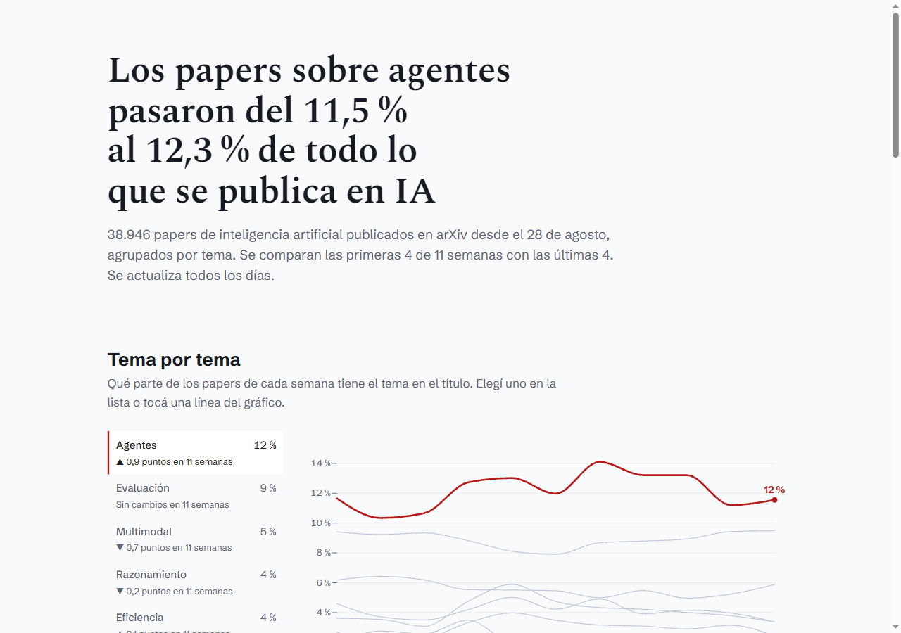

# Radar de IA

**[Ver el tablero](https://frmahon.github.io/radar-ia/)**

Qué se investiga en inteligencia artificial, actualizado todos los días: los papers de IA que se publican en arXiv, agrupados por tema y semana, y los modelos que más crecen en Hugging Face.



En la página se puede:

- elegir un tema (agentes, razonamiento, RAG, seguridad, multimodal…) y ver cómo cambió su peso semana a semana;
- buscar entre los papers de los últimos 7 días, filtrados por ese tema;
- ver los 100 modelos en tendencia en Hugging Face, cuánto subieron o bajaron desde ayer y filtrarlos por tarea;
- revisar cómo corrió el pipeline y qué controles de calidad pasó.

## Cómo funciona

```
arXiv API ─────┐                               ┌─ staging ─ temas ─ marts ─┐
               ├─> crudo (JSONL.gz por día) ─> │          SQLite           │ ─> controles ─> JSON ─> GitHub Pages
Hugging Face ──┘                               └───────────────────────────┘
```

| Paso | Qué hace | Dónde |
|---|---|---|
| Extracción | Pide a arXiv los papers de cs.AI, cs.CL, cs.LG y cs.CV de cada día (ventana de 12 semanas, respetando su límite de un pedido cada 3 s) y saca una foto diaria del top 100 de Hugging Face. Incremental: solo baja los días que faltan y vuelve a pedir los últimos 3, porque arXiv publica con demora. | `src/radar/arxiv.py`, `src/radar/hf.py` |
| Capa cruda | Un archivo JSONL comprimido por día y fuente, escrito de forma atómica. Es la fuente de verdad: el warehouse se reconstruye entero desde acá en cada corrida. | `data/raw/` |
| Staging | Tipa y limpia con SQL; deja una fila por paper (su última versión) y una por modelo en cada foto. | `src/radar/sql/10_staging.sql` |
| Temas | Taxonomía de 10 temas y etiquetado por expresiones regulares sobre el título, con una función `REGEXP` registrada en SQLite desde Python. No usa el resumen: ahí casi todos dicen "benchmark" o "agent" de pasada y eso infla los temas. | `src/radar/sql/20_topics.sql` |
| Marts | Proporción semanal por tema (solo semanas completas), cambio entre el principio y el final del período, y movimientos del ranking de modelos. | `src/radar/sql/30_marts.sql` |
| Controles | Cada control es un `SELECT` que devuelve las filas que lo rompen: unicidad, campos completos, integridad referencial, rangos, huecos de volumen y frescura. Si uno falla, no se publica. | `src/radar/sql/checks/` |
| Publicación | Exporta dos JSON chicos y GitHub Actions publica la página estática todos los días. | `src/radar/export.py`, `site/`, `.github/workflows/pipeline.yml` |

### Decisiones

- **Solo librería estándar y SQLite.** Sin pandas ni servidores: la corrida completa usa unos pocos MB de memoria y no hay nada que instalar para correrla.
- **Dónde vive cada dato.** arXiv se puede volver a descargar, así que se guarda en la caché de GitHub Actions (si se borra, el pipeline la reconstruye solo). Las fotos de Hugging Face no se pueden recuperar después, así que se versionan en el repo.
- **Temas por reglas, no por un modelo.** Es rápido, barato y explicable; la contra es que se pierden papers que hablan de un tema con otras palabras o solo en el resumen. El siguiente paso sería un clasificador con embeddings.
- **Semanas completas.** El gráfico descarta la primera y la última semana si están incompletas, para que no parezcan caídas.

## Correrlo

Requiere Python 3.10 o más nuevo.

```bash
pip install -e ".[dev]"
radar run          # extrae, carga, transforma, controla y exporta (la primera vez tarda unos 10 minutos)
python -m http.server -d site 8000   # y abrir http://localhost:8000
pytest -q          # tests
```

`radar extract` y `radar build` corren cada mitad por separado.

## Fuentes

- [arXiv API](https://info.arxiv.org/help/api/index.html). Gracias a arXiv por el uso de su interoperabilidad de acceso abierto.
- [Hugging Face Hub API](https://huggingface.co/docs/hub/api), endpoint público de modelos ordenados por tendencia.
